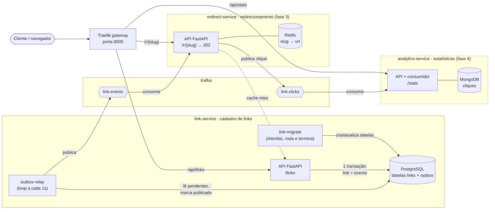
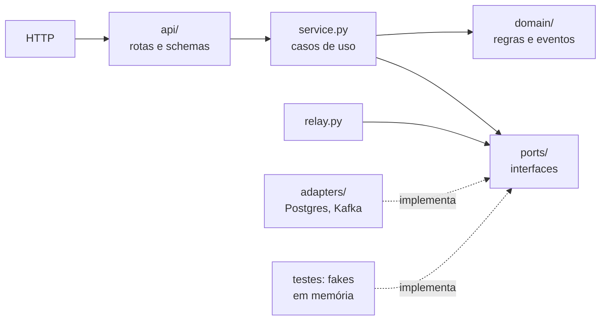

# Arquitetura

O sistema tem **3 microsserviços**, um por assunto do negócio (domínio). Cada um é dono do
próprio banco, e nenhum outro serviço acessa esse banco (*database per service*). Os serviços
não se chamam diretamente para escrever: eles se avisam por eventos no Kafka.



Contorno tracejado: serviço planejado, ainda não implementado.

### Microsserviços × containers

Um microsserviço pode rodar em mais de um container. O link-service usa a mesma imagem
Docker com três comandos diferentes:

| Container      | Comando                            | Função                                                 |
|----------------|------------------------------------|--------------------------------------------------------|
| `link-migrate` | `python -m link_service.migrate`   | Aplica as migrations do Alembic e termina              |
| `link-service` | `uvicorn link_service.main:app`    | API HTTP: cria, consulta, lista e apaga links          |
| `outbox-relay` | `python -m link_service.relay`     | Lê a tabela `outbox` e publica os eventos no Kafka     |

O `outbox-relay` não é um microsserviço à parte: ele pertence ao link-service, usa o mesmo
código e é o único processo, além da API, que acessa o banco dele.

O resto do Compose é infraestrutura: Postgres, Redis, MongoDB, Kafka e Traefik. Com
`--profile tools` sobem também as interfaces de inspeção (Kafka UI e Mongo Express), que são
ferramentas de terceiros e não fazem parte do sistema.

### Dentro de um serviço (arquitetura hexagonal)



O domínio e os casos de uso dependem só das interfaces em `ports/`. Em produção elas são
implementadas pelos adapters (Postgres, Kafka); nos testes unitários, por fakes em memória.
Por isso os testes rodam sem Docker.

## Transactional Outbox (link-service)

Problema: gravar o link no Postgres **e** publicar o evento no Kafka são duas operações em
sistemas diferentes. Se o processo cair entre elas, o banco e o barramento divergem.

Solução:

1. Na mesma transação, o link-service grava o link **e** uma linha na tabela `outbox`.
2. O `outbox-relay` lê as linhas pendentes (`SELECT ... FOR UPDATE SKIP LOCKED`), publica no
   Kafka e marca como publicadas.
3. Se o relay cair depois de publicar e antes de marcar, o evento é republicado. Por isso a
   entrega é *at-least-once* e os consumidores precisam ser idempotentes (`event_id`).

```mermaid
sequenceDiagram
    participant API as link-service
    participant DB as PostgreSQL
    participant R as outbox-relay
    participant K as Kafka
    API->>DB: BEGIN; INSERT link; INSERT outbox; COMMIT
    loop polling
        R->>DB: SELECT pending FOR UPDATE SKIP LOCKED
        R->>K: publish link.created
        R->>DB: UPDATE outbox SET published_at = now()
    end
```

## Por que não há outbox no redirect-service?

Ele não tem banco transacional e perder um clique ocasional é aceitável para analytics.
Então ele publica `link.clicked` direto no Kafka, sem bloquear a resposta 302.

## Contratos

Os eventos ficam em [`libs/contracts`](../libs/contracts). Todos usam o mesmo envelope:
`event_id`, `event_type`, `occurred_at`, `version` e `payload`.

| Tópico        | Evento         | Produtor          | Consumidor        |
|---------------|----------------|-------------------|-------------------|
| `link.events` | `link.created` | link-service      | redirect-service  |
| `link.events` | `link.deleted` | link-service      | redirect-service  |
| `link.clicks` | `link.clicked` | redirect-service  | analytics-service |
